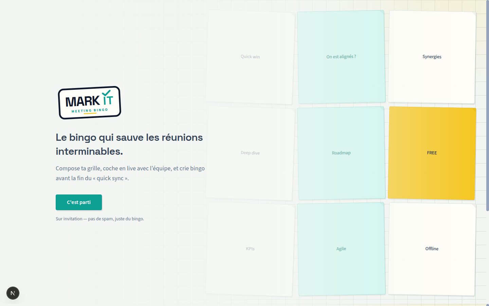
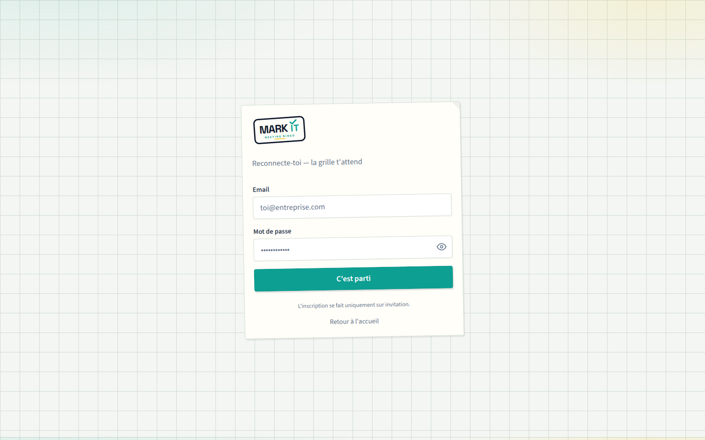
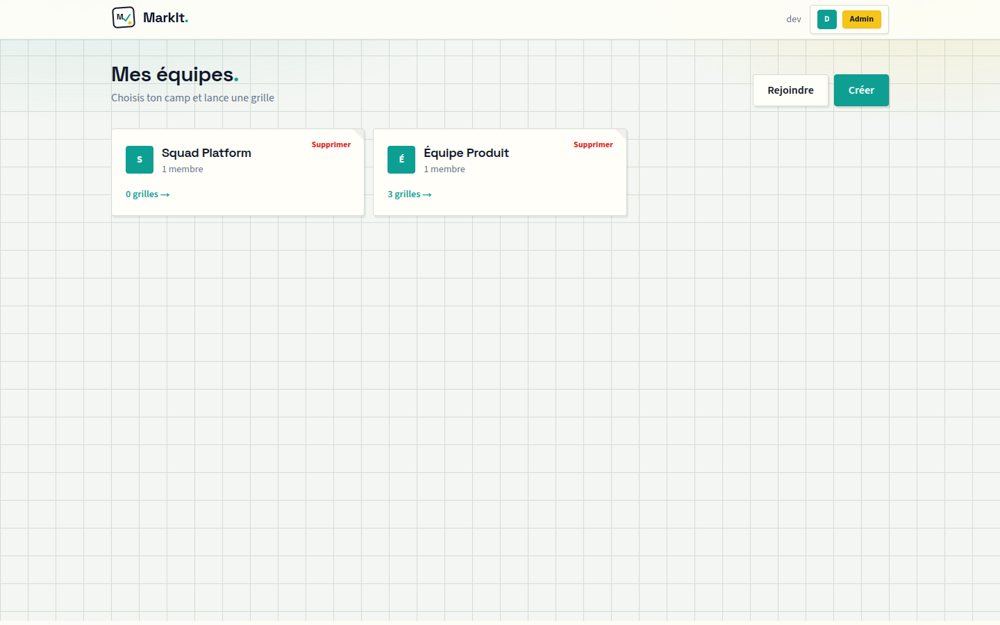
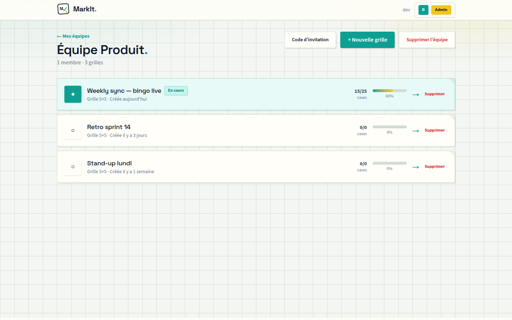
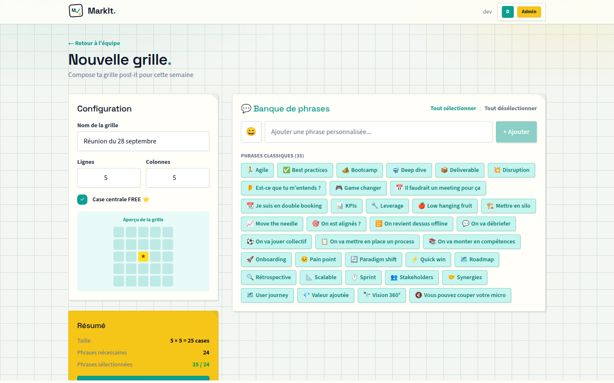
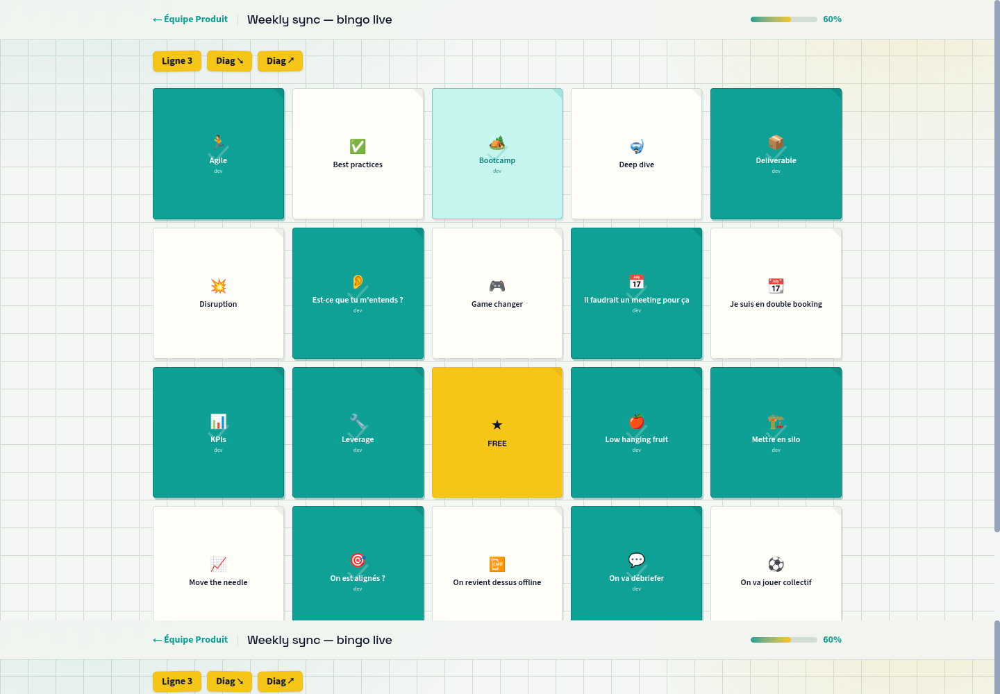

# MarkIt — Meeting Bingo

Make your weekly team meetings infinitely more fun with shared bingo boards in real time.



More detail (architecture, Docker production, CI, backups): [Wiki](https://github.com/mcinquin/markit/wiki).

---

## Features

- **Teams** — create a team, invite with a code, roles `OWNER` / `ADMIN` / `MEMBER`
- **Boards** — configurable size (2×2–10×10), optional FREE center, phrase bank + custom phrases
- **Live play** — shared board via Socket.io, instant cell checks, auto bingo + confetti
- **History** — past boards with date and completion rate
- **Admin** — users and invite codes

---

## Screenshots

### Sign-in



### Dashboard — teams



### Team — boards & progress



### Board creation



### Live play — bingo celebration



---

## Requirements

- Node.js 26 (see `.nvmrc`)
- npm
- Docker + Docker Compose (PostgreSQL locally, or full stack)

## Quick start (local)

```bash
cp .env.example .env
# Set NEXTAUTH_SECRET (openssl rand -base64 32)
# Keep NEXTAUTH_URL=http://localhost:3000 for local HTTP
npm ci
docker compose up postgres -d
npm run db:migrate:deploy
npm run db:seed
npm run dev
```

Open [http://localhost:3000](http://localhost:3000). With `ADMIN_EMAIL` / `ADMIN_PASSWORD` (≥ 12 chars) in `.env`, the seed creates the admin account (`mustChangePassword` → `/account` on first login).

## Quick start (Docker, no reverse proxy)

For a simple local or LAN run over HTTP — no Apache/Nginx in front:

```bash
cp .env.example .env
# Required in .env:
#   POSTGRES_DB_PASSWORD=<openssl rand -base64 32>
#   NEXTAUTH_SECRET=<openssl rand -base64 32>
#   NEXTAUTH_URL=http://127.0.0.1:3000
docker compose up -d --build
```

Open [http://127.0.0.1:3000](http://127.0.0.1:3000). The entrypoint runs migrations and seeds on first start.

The app binds to `127.0.0.1` only. Production with HTTPS and Apache is documented in the [wiki](https://github.com/mcinquin/markit/wiki/Docker).

## Documentation

| Topic | Where |
| ----- | ----- |
| Architecture, stack, features | [Wiki · Architecture](https://github.com/mcinquin/markit/wiki/Architecture) |
| Docker / GHCR / Apache reverse proxy | [Wiki · Docker](https://github.com/mcinquin/markit/wiki/Docker) |
| PostgreSQL, migrations, backup / restore | [Wiki · Data and backup](https://github.com/mcinquin/markit/wiki/Data-and-backup) |
| CI, releases, GHCR | [Wiki · CI and releases](https://github.com/mcinquin/markit/wiki/CI-and-releases) |
| Scripts, quality, contributing | [Wiki · Development](https://github.com/mcinquin/markit/wiki/Development) |
| Security | [SECURITY.md](SECURITY.md) · [Wiki · Security](https://github.com/mcinquin/markit/wiki/Security) |
